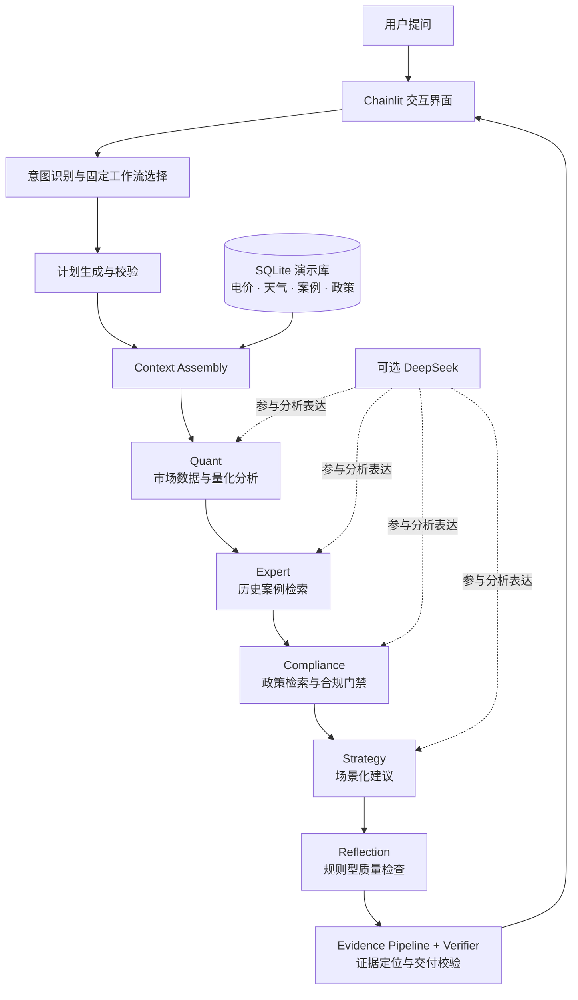

# ⚡ PowerMind Agent

**面向电力交易场景的多智能体协作演示系统**

以山东省为例，把市场数据、交易案例和政策规则组织进一条可追溯的分析链路：**任务识别 → 数据装配 → 量化分析 → 案例检索 → 合规检查 → 策略生成 → 反思与证据校验**。通过 Chainlit 查看业务结果和每一步的执行记录。

`LangGraph` 工作流编排 · `SQLite` 本地演示数据 · `DeepSeek` 可选分析表达 · `Chainlit` 交互界面

> **演示边界**：仓库中的市场数据、政策条款和交易案例均为模拟数据。输出仅供产品与技术演示，不代表实时行情、真实电价预测或交易指令；系统不会自动申报、成交或锁价。

## 项目架构



主入口是 [`PowerMindAgentV3`](agents/react_graph_agent.py)，基于单个 LangGraph `StateGraph` 执行任务。各任务复用同一套图结构，并由 [`workflows/fixed_workflows.py`](workflows/fixed_workflows.py) 定义所需步骤；出现异常时，图内的故障策略会决定重试、降级、等待人工处理或安全终止。页面展示的是可审计的执行记录，不是模型的隐式思维链。

## 五类演示任务

| 场景 | 可以这样提问 | 主要输出 |
| --- | --- | --- |
| 市场日报 | `生成山东今天的市场日报` | 市场概况、影响因素与风险提示 |
| 日前申报建议 | `山东明天日前申报怎么做？` | 分段申报思路与合规检查 |
| 实时交易窗口分析 | `山东当前实时交易怎么调整？` | 基于**存储快照**的日内分析；不代表实时行情 |
| 政策查询 | `山东偏差考核标准是什么？` | 模拟政策检索结果与来源定位 |
| 中长期锁价分析 | `山东中长期应该锁多少电量？` | 合约覆盖、分批锁价思路与风险提示 |

意图词和任务映射维护在 [`intents/task_intents.yaml`](intents/task_intents.yaml)。演示界面当前仅支持山东省；其他省份的配置或模块不等于已完成相应地区的数据接入。

## 运行模式

| 模式 | 如何启用 | 行为 |
| --- | --- | --- |
| 本地离线演示（默认） | 不配置 `DEEPSEEK_API_KEY` | 使用自动生成的 SQLite 演示数据与确定性工作流，无需模型 API |
| DeepSeek 辅助演示 | 在 `config/.env` 中配置有效的 `DEEPSEEK_API_KEY` | 基于同一份演示数据参与分析表达；调用失败时保留数据驱动的降级路径 |

演示版的政策和案例检索使用 SQLite 数据上的检索实现。仓库还包含 ChromaDB、混合检索、量化插件等扩展代码，但它们不是运行下方五类演示任务的前置条件，也不意味着已经连接生产数据源。

## 快速开始

建议使用 **Python 3.11 或 3.12**。在项目根目录执行：

```bash
git clone https://github.com/whisper621/powermind-agent.git
cd powermind-agent
python -m venv .venv
```

激活虚拟环境：

```powershell
# Windows PowerShell
.\.venv\Scripts\Activate.ps1
```

```bash
# macOS / Linux
source .venv/bin/activate
```

安装并启动：

```bash
python -m pip install -r requirements.txt
python run_demo.py
```

`run_demo.py` 会初始化或更新本地演示数据库，启动 Chainlit，并在服务就绪后尝试打开 <http://127.0.0.1:8000>。首次安装 PyTorch、ChromaDB 等依赖可能需要一些时间。

如果希望分步启动：

```bash
python -m scripts.seed_demo_v1
chainlit run app_chainlit.py --port 8000
```

### 可选：启用 DeepSeek

将 [`config/.env.example`](config/.env.example) 复制为 `config/.env`，把示例值替换为自己的有效 `DEEPSEEK_API_KEY`，然后重新启动。**仅运行离线演示时无需创建该文件**；示例占位值不能作为真实密钥使用。`config/.env` 已加入 Git 忽略规则。

## 技术栈

| 层级 | 当前项目中的用途 |
| --- | --- |
| Python + LangGraph / LangChain | 状态图、工作流编排与组件接口 |
| Chainlit | 对话入口、业务结果与执行步骤展示 |
| SQLite | 可重建的市场、天气、政策、案例与审计演示数据 |
| DeepSeek（可选） | 在演示数据约束下辅助生成分析文字 |
| Pydantic / PyYAML | 数据契约与任务、提示词配置 |
| ChromaDB / PyTorch | 检索与预测相关扩展模块；不属于五类任务的默认演示链路 |

## 项目结构

```text
powermind-agent/
├── app_chainlit.py         # Chainlit 对话界面
├── run_demo.py             # 一键演示入口
├── agents/                # 主图、子 Agent、反思与校验
├── workflows/             # 五类固定工作流与计划校验
├── intents/               # 意图词与任务映射
├── services/              # SQLite 仓储、上下文、审计与证据服务
├── retrieval/             # 演示检索及扩展检索组件
├── quant/                 # 可插拔量化与预测实验模块
├── prompts/               # 提示词注册表与运行时模板
├── scripts/seed_demo_v1.py # 可重建的演示数据库种子脚本
├── data/                  # 演示数据与知识文档
└── tests/                 # 自动化测试
```

## 设计要点

1. **固定工作流与合规门禁**：高风险任务在策略输出前经过合规节点，业务步骤由工作流规格约束。
2. **证据可追溯**：结果汇总数据库证据 ID 和来源定位，Verifier 检查演示数据的证据覆盖与交付条件；这不等于对现实市场事实的验证。
3. **可离线复现**：种子脚本生成本地 SQLite 数据，不依赖外部行情服务或模型密钥即可跑通五类任务。
4. **可观察的降级路径**：模型不可用时展示降级状态，继续使用本地演示数据形成结果；无法安全继续的任务由故障策略处理。

## 测试

```bash
python -m pytest tests/test_demo_closed_loop.py -q
# 运行完整测试集
python -m pytest tests -q
```

闭环测试覆盖演示数据生成、检索、提示词注册以及五类任务的主要执行路径。仓库仍是原型与离线演示代码；接入真实市场数据、生产预测模型或交易系统，需要另行完成数据校验、安全评审和集成测试。
